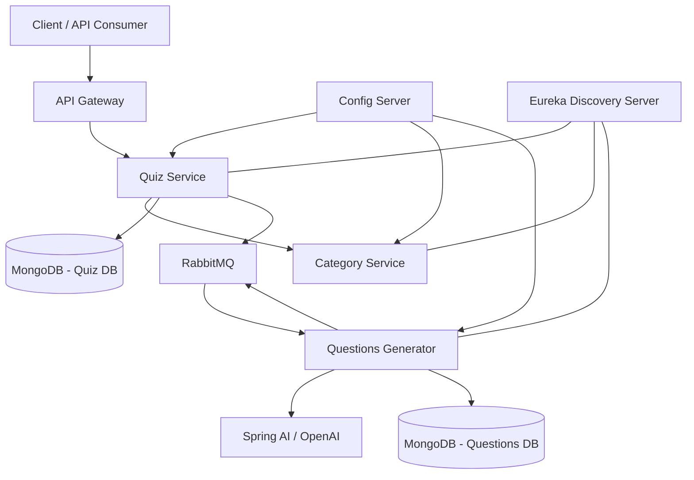

# Question-Quiz-Microservices
This is complete Java spring boot micro services project 
# Question Quiz Microservices

A distributed, AI-powered Quiz Management System built using **Java, Spring Boot, Spring Cloud, MongoDB, RabbitMQ, and Spring AI**.

The project demonstrates microservices architecture, service-to-service communication, centralized configuration, service discovery, asynchronous messaging, and AI-assisted question generation.

## Overview

Question Quiz Microservices is a backend application designed to manage quizzes and questions through independently deployable microservices.

The system is designed to separate business responsibilities into individual services, making the application easier to maintain, extend, and scale.

It also incorporates an AI-powered question-generation component that uses Spring AI and OpenAI to generate quiz questions based on quiz requirements.

## Architecture

The application follows a distributed microservices architecture.

### High-Level Architecture



*Note: The diagram represents the intended integration architecture. Some AI messaging and acknowledgement flows are still under development.*

## Microservices

| Service | Responsibility |
|---|---|
| API Gateway | Central entry point for client requests |
| Config Server | Centralized configuration management |
| Eureka Discovery Server | Service registration and discovery |
| Quiz Service | Quiz creation and management |
| Category Service | Category-related operations |
| Questions Generator | AI-assisted question generation |

### 1. Quiz Service

- Responsible for quiz-related business logic.
- Manages quiz information.
- Integrates with the Category Service.
- Uses MongoDB for quiz data persistence.
- Publishes quiz creation events through RabbitMQ.

### 2. Category Service

- Handles category-related operations.
- Provides category information to other services.
- Supports communication with the Quiz Service.

### 3. Questions Generator

- Generates quiz questions using Spring AI and OpenAI.
- Uses the configured GPT-4o-mini model.
- Processes quiz-generation messages through RabbitMQ.
- Maps generated question data into application DTOs.
- Persists generated questions in MongoDB.

### 4. API Gateway

- Provides a centralized entry point to backend services.
- Designed to route incoming requests to appropriate microservices.

### 5. Config Server

- Centralizes application configuration.
- Helps maintain consistent configuration across microservices.

### 6. Eureka Discovery Server

- Provides service registration and discovery.
- Allows microservices to locate one another without hardcoding service instances.

## Technology Stack

| Technology | Purpose |
|---|---|
| Java 21 | Backend programming language |
| Spring Boot | Microservice development |
| Spring Cloud | Distributed application infrastructure |
| Spring Cloud Gateway | API routing |
| Netflix Eureka | Service discovery |
| Spring Cloud Config | Centralized configuration |
| Spring Data MongoDB | NoSQL persistence |
| MongoDB | Quiz and question storage |
| PostgreSQL | Relational database for category data, where configured |
| RabbitMQ | Asynchronous messaging |
| Spring Cloud Function | Message-driven processing |
| Spring AI | AI integration |
| OpenAI GPT-4o-mini | AI question generation |
| Maven | Dependency and build management |
| Docker | Containerization and infrastructure |

## Asynchronous Communication

RabbitMQ is used to support asynchronous communication between the Quiz Service and Questions Generator.

The configured messaging destinations include:

- `quiz-created` – Used to communicate quiz creation events.
- `acknowledge-quiz` – Intended for acknowledgement messages.

The Questions Generator uses a Spring Cloud Function consumer configured as `getQuizBinding`.

This approach helps decouple quiz creation from the question-generation workflow.

## AI Integration

The project integrates Spring AI with OpenAI to explore automated quiz-question generation.

### Workflow

1. A quiz creation request is received.
2. Quiz information is processed by the Quiz Service.
3. A quiz-created event is published to RabbitMQ.
4. The Questions Generator consumes the event.
5. Spring AI communicates with the configured OpenAI model.
6. Generated questions are mapped into application objects.
7. Questions are persisted in MongoDB.

**AI integration status:** Under development. The end-to-end message processing and acknowledgement flow is being refined.

## Database Design

The application uses a database-per-service approach to separate data responsibilities.

| Database | Service | Technology |
|---|---|---|
| quizdb | Quiz Service | MongoDB |
| questionsdb | Questions Generator | MongoDB |
| Category database | Category Service | PostgreSQL, where configured |

This separation helps reduce direct database dependencies between microservices.

## Configuration

The project uses Spring Cloud Config Server for centralized configuration.

Typical local configuration includes:

| Component | Port |
|---|---:|
| API Gateway | 9093 |
| Quiz Service | 9092 |
| Questions Generator | 9097 |
| Config Server | 9094 |
| Eureka Discovery Server | 8761 |
| MongoDB | 27017 |
| RabbitMQ | 5672 |

Category Service port and database settings should be checked against its current application configuration.

## Getting Started

### Prerequisites

Make sure you have the following installed:

- Java 21
- Maven
- MongoDB
- RabbitMQ
- Docker (if using containerized infrastructure)
- Git

### 1. Clone the Repository

```bash
git clone https://github.com/asharsyed713-commits/Question-Quiz-Microservices.git

cd Question-Quiz-Microservices
```

### 2. Start Infrastructure

Start MongoDB and RabbitMQ before starting the dependent services.

Ensure the required databases and RabbitMQ configuration are available.

### 3. Start Config Server

Start the Config Server first so that other services can retrieve their configurations.

### 4. Start Eureka Server

Start the Eureka Discovery Server and verify that it is accessible.

### 5. Start Backend Microservices

Start the Category Service, Quiz Service, and Questions Generator using their respective Maven projects.

For each service:

```bash
mvn clean install
mvn spring-boot:run
```

### 6. Start API Gateway

Start the API Gateway after the dependent services are available.

### 7. Verify Service Registration

Open the Eureka dashboard:

```text
http://localhost:8761
```

Verify that the configured services are registered.

## Configuration and Security

Sensitive credentials should not be committed to GitHub.

Configure the following through environment variables or your local configuration:

```properties
OPENAI_API_KEY=your-openai-api-key
```

Also configure database credentials and RabbitMQ credentials according to your local environment.

Use an `.env.example` or equivalent sample configuration file to document required variables without exposing actual secrets.

## Key Engineering Concepts Demonstrated

- Microservices architecture
- Service discovery using Eureka
- Centralized configuration using Spring Cloud Config
- API Gateway and request routing
- Inter-service communication
- Asynchronous messaging using RabbitMQ
- Event-driven architecture
- NoSQL database integration
- Relational database integration
- AI integration using Spring AI
- External LLM integration
- Maven-based project management

## Future Enhancements

- Complete end-to-end AI question-generation workflow.
- Implement reliable acknowledgement and retry handling.
- Add centralized logging and distributed tracing.
- Implement authentication and authorization.
- Add comprehensive unit and integration tests.
- Containerize all microservices using Docker.
- Introduce Kubernetes deployment.
- Add monitoring and observability.

## Author

**Ashar Farogh**

Java Backend Developer | Spring Boot | Microservices | AI Integration

GitHub: https://github.com/asharsyed713-commits

---

*This project is developed as a practical exploration of distributed backend systems and AI-powered application development using the Java and Spring ecosystem.*